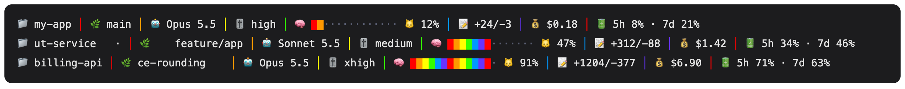

# claude-nyan 🐱🌈

**Twenty Claude Code tabs open. Which one is done?**

claude-nyan puts the answer in the tab bar: a colour-turning circle while a
session works, a green check the moment it has an answer. It also replaces the
status line with a rainbow one, where your context window is the nyan cat's trail.


<sub>Illustration of the Terminal.app tab bar, with the same markers the scripts write.</sub>



<sub>Real output of `statusline.sh`, rendered; the project names are made up.</sub>

## What you get

- **A signal in every tab.** `🔴 🟠 🟡 🔵 🟣` turns while Claude works, `✅` when it stops, so you can see it from any tab.
- **Tabs with names.** `!nyan name payments` from inside a session. The name outlives the session.
- **A status line worth reading.** Project and branch (long names scroll), model, effort, context as a trail, lines changed, cost, and your 5-hour and 7-day usage.
- **Nothing leaves your machine.** Shell scripts only: no network calls, no telemetry.


## Requirements

- macOS and **Terminal.app**. The tab signal leans on behaviour measured on that terminal, and has not been tried on any other.
- [Claude Code](https://claude.com/claude-code).
- `jq`: `brew install jq`.

The status line itself needs only `bash`, `jq` and a 24-bit colour terminal, so it may work elsewhere; that is untested.

## Install

The folder matters, the settings point at it:

```sh
git clone https://github.com/Bariscanates404/claude-nyan.git ~/.local/share/claude-nyan
bash ~/.local/share/claude-nyan/install-settings.sh
```

Then restart Claude Code. Hooks and the env flag are read once, at session start.

The installer backs up `~/.claude/settings.json`, refuses to touch it if it is not valid JSON, keeps your other hooks, and is safe to run twice. It sets:

| what | why |
|---|---|
| `statusLine` | the rainbow bar, refreshed every second so names can scroll |
| `CLAUDE_CODE_DISABLE_TERMINAL_TITLE=1` | otherwise Claude Code overwrites your tab name as soon as it starts working |
| `SessionStart`, `UserPromptSubmit`, `Stop`, `SessionEnd` hooks | name the tab, turn the circle, write the check, clean up |
| `~/.local/bin/nyan` | a link to the naming command; keep `~/.local/bin` on your `PATH` |

**One step by hand, recommended:** Terminal → Settings → Profiles → *your profile* → Window → Title: untick *Active process name* and *Active process arguments*. No script can do this for you, see below.

**Update:** `git -C ~/.local/share/claude-nyan pull`

**Uninstall:** in `~/.claude/settings.json` delete `statusLine`, the `CLAUDE_CODE_DISABLE_TERMINAL_TITLE` line and every hook whose command holds `claude-nyan` (or restore the backup the installer printed, if you changed nothing since), then `rm -rf ~/.local/share/claude-nyan ~/.local/bin/nyan`.

## Name a tab

The tab is running Claude, not a shell, so run it from inside the session with
a leading `!`:

```
!nyan name gate     name this tab
!nyan name          print the current name
!nyan clear         drop it, back to folder · branch
!nyan list          every tab and its name
```

A name is stored against the tab's tty, so it outlives the session.

## How it works, and why it works that way

Everything below was measured on the author's machine. Most of it is the opposite of
what seemed obvious first.

**Claude Code owns the terminal title, so we take it away from it.** It writes
the title only while it is working and goes quiet when idle: a title written
into that silence survived 0s, 2s and 6s, while the same write during a working
turn was overwritten in under a second. That is not enough — a name set with
`nyan` would vanish the moment you sent a prompt. So `install-settings.sh` sets
`CLAUDE_CODE_DISABLE_TERMINAL_TITLE=1`, which the binary reads as a plain truthy
check, and the title becomes ours alone. The cost is that the working marker is
now ours to draw too, which is what `nyan-spin.sh` does.

**`OSC 1` paints the tab pill; `OSC 2` paints the window title.** This one was
measured backwards twice, because AppleScript's `custom title` property reads
OSC 2 and is completely blind to OSC 1 — so probing with AppleScript "proves"
that OSC 2 owns everything. Only looking at the tab bar settles it.

**Clearing OSC 2 does not hand the window title back to nothing.** It was
cleared here at first, on the grounds that carrying the name in both made the
hover tooltip print it twice. What that actually bought was a window title
reading `caffeinate ◂ claude --permission-mode bypassPermissions`, because
Terminal composes that bar out of four independent parts and only one of them
is ours:

```
you  —  ✅ my-app · fix-login  —  caffeinate ◂ claude …  —  213×53
dir      OSC 2, ours                "active process name"     dimensions
```

So OSC 2 carries the name too, and the doubled tooltip is the price.

**The other three parts are profile checkboxes, not escape sequences.** No
script can remove `caffeinate` from that line, and neither can AppleScript:
Terminal exposes only `custom title`, `device name`, `shell path`, `settings
name` and `window size` as scriptable title toggles — the active process name
is not among them, and the profile's own `Show…InTitle` keys are rewritten by
Terminal when it quits, so editing them underneath a running Terminal does not
stick. It is **Settings → Profiles → *your profile* → Window → Title**, by
hand: untick *Active process name* and *Active process arguments*. Applies at
once, no restart.

**Tab background colour was built and then thrown away.** `OSC 11` works
perfectly and Claude Code never touches it. It solved nothing: you only see a
tab's background when that tab is active, so it could never answer "which of
these fifty is done".

**`statusLine.refreshInterval` is in seconds.** Three idle tabs each refreshed
exactly 3 times across 45 seconds at the default of 15. It is set to 1 here,
because the scrolling names move two characters a second and at 15 that reads as
frozen rather than alive. That is affordable only because the bar was cut from
74ms to 30ms per refresh: one `jq` call instead of nine, a 10-second branch
cache, and no `basename` or command-substitution subshells.

**The context meter's rainbow is coloured by position, never by time.** It is a
meter, not an animation. On a line that redraws once a second, anything that
moves for its own sake reads as broken.

**Green is absent from the working rotation.** Done is a green square check, and
colour is what the eye catches first — a green circle a fifth of the time would
blunt the one signal this whole thing exists for.

## Bugs worth not reintroducing

The first two are from building it. The rest came out of a three-way review of
the finished thing, and four of them were in code written *during* that review —
including both halves of the lock that was added to fix one of the others.

**A pid in a file is a claim about the past, not a handle.** The process it
named can be gone and the number reissued to something unrelated, and every
`kill` here is silenced with `2>/dev/null`, so acting on the number alone meant
SIGTERM to a stranger with nothing printed anywhere. Measured: the old path
killed an unrelated `sleep` on the first try. Check what a pid *is*
(`nyan_is_spinner`, `nyan_is_claude`) before killing it or trusting it alive.

**`kill` returns before the process dies.** It queues a signal. Painting the
done marker straight after it let a spinner already past its `sleep` land one
more frame *after* the check mark, leaving a finished answer turning a circle
with nothing scheduled to repaint it. `nyan_stop_spinner` waits for the exit.

**A lock you failed to take is not yours to release.** The wait in `nyan_lock`
is capped, so a caller can reach its cleanup path without the lock — which is
exactly the contended case the lock exists for. An unconditional `rm -rf` there
deletes the *winner's* live lock and lets a third process take a mutex two
others believe they hold. `nyan_unlock` checks the owner stamp instead.

**Never clear a stale lock in place.** Two contenders can read the same mtime in
the same poll window and both rule it stale; the slower `rm` then deletes the
fresh lock the faster one already took. Rename it aside and delete the rename —
only one `mv` can win.

**An iteration count is not a deadline.** The spinner's "two hour" safety cap
counted `sleep 0.25` calls, so closing the lid stopped the clock and the cap
could span a day. That whole span is when an orphan can paint into a reissued
tty. It is wall-clock now, and three minutes when the owning session cannot be
resolved at all.

**A title is not text, it is the inside of an escape sequence.** A control byte
in it does not print — it terminates the OSC and whatever follows is parsed as
a fresh command to the terminal. `nyan name` takes whatever was pasted, and the
derived name is a directory basename, which APFS lets carry raw ESC and BEL.
Stripped in `nyan_title` and in `statusline.sh`, with parameter expansion rather
than `tr`, because a fork four times a second in every working tab is not free.

**`${cwd//\//_}` is not injective.** `/a/aa_bb` and `/a/aa/bb` both became
`branch-_a_aa_bb`, so two unrelated repos shared one branch cache and a tab
showed its neighbour's branch for up to `BRANCH_TTL`. Double the underscores
before replacing the slashes.

**`floor` on a non-number aborts the whole jq filter, not one field.** A single
mistyped value in the payload blanked every field on the status line at once.
Type-guard anything arithmetic before it reaches `floor`.

**Under `set -e`, `A="$(cmd)"` as the tail of `x || A` is not exempt.** A missing
`jq` made the installer exit silently — the only one of its four failure checks
that printed nothing.

## The original two

**Never split multi-column `ps` output.** `ps -o ppid=,tty=,comm=` and trusting
field 2 as the tty once resolved a tty of `go`: a blank column shifts every
field after it. The name was filed under `names/go` and the escape written to
`/dev/go`. Ask for one field at a time and validate the answer against
`ttys*|ttyp*|console`.

**`> "$dev" 2>/dev/null` does not suppress a redirection failure.**
Redirections are applied left to right, so the error is reported on the stderr
in effect *before* `2>/dev/null`. Swapping the order works in bash and still
leaks in zsh. `{ ...; } 2>/dev/null` suppresses in both, and checking
`[ -c "$dev" ] && [ -w "$dev" ]` first is better than either.

Both lived in three copy-pasted `walk_up` functions, which is why `lib.sh` now
owns the shared helpers.

## Files

| file | job |
|---|---|
| `lib.sh` | tty resolution, claude pid lookup, the one title writer |
| `mark-done.sh` | the hook entry point: `work`, `done`, `clear` |
| `nyan-spin.sh` | detached daemon, turns the circle while Claude works |
| `statusline.sh` | the status line |
| `nyan` | the tab naming command; `~/.local/bin/nyan` is a symlink to it, so there is one copy to fix, not two |
| `install-settings.sh` | idempotent `jq` patch of `~/.claude/settings.json` |

## Tuning

The four knobs are at the top of `statusline.sh`: `WIN_PROJECT`, `WIN_BRANCH`,
`SCROLL`, `BRANCH_TTL`. The marker set is at the top of `mark-done.sh` and
`nyan-spin.sh`.

## License

[MIT](LICENSE). A personal tool shared as is; not affiliated with Anthropic.
